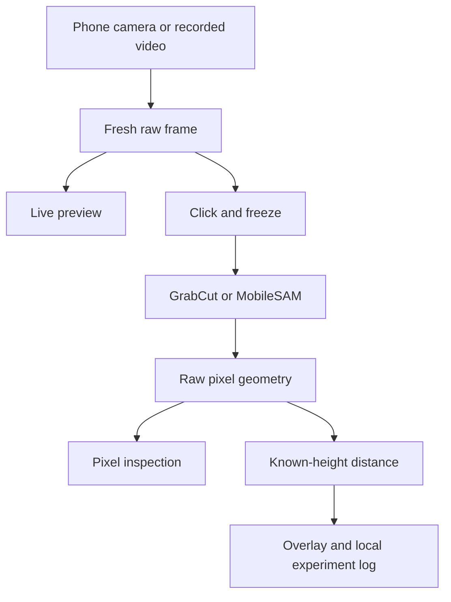

# Ping Pong Robot

**Work in progress: camera vision and calibrated-object distance measurement.**

I am building a camera-guided ping pong robot. This repository contains the current **Vision** and **Brain** software: live video from an old smartphone, interactive object segmentation, pixel measurements and distance estimates for objects with known dimensions. The microcontroller, pan-tilt mechanism and ball launcher are planned; this is not yet a robot that tracks or returns ping pong balls.

Built by **Srijan Kumar Samrat**. Planning began around **29 October 2026**.

## What works in this software

- Read IP Webcam's MJPEG video over local Wi-Fi, or use a USB camera/recorded video.
- Select an object on an exact frozen frame and segment it with OpenCV GrabCut or optional MobileSAM.
- Inspect its bounding-box dimensions and centroid in the original camera pixels.
- Estimate distance using a known object height and a resolution-specific camera calibration.
- Keep the video reader separate from the interface; reject stale frames after a disconnect.
- Save measurement records and optional ground-truth errors to local JSONL files.

The refactored software has automated synthetic/offline checks. Live phone-camera, MobileSAM and mechanical testing must still be performed on the actual setup; see [testing](docs/testing.md).

## Original scripts and the new structure

| Original | New location / command | Purpose |
| --- | --- | --- |
| `Video.py` | `vision/stream.py` and `view` | Camera acquisition and live display |
| `Pixel.py` | `brain/segmentation.py` and `pixels` | Click, freeze, prompt and inspect an object |
| `Dis_measure.py` | `brain/measurement.py`, `brain/geometry.py` and `measure` | Robust pixel dimensions and calibrated distance |

The common interface is in `app.py`; camera settings, object dimensions and calibration live in a local TOML file instead of being copied into three scripts.



## Quick start on Windows

Requires **Python 3.11 or newer** and a desktop display. Start in the repository directory.

```powershell
python -m venv .venv
.venv\Scripts\Activate.ps1
python -m pip install -r requirements.txt
Copy-Item config.example.toml config.local.toml
```

If PowerShell does not permit activation, use `.venv\Scripts\python.exe` in place of `python`; no policy change is necessary. On macOS/Linux, activate with `source .venv/bin/activate` and copy the config with `cp`.

1. Start the IP Webcam server on the phone and connect the phone and laptop to the same local network.
2. Edit `camera.source` in `config.local.toml`, for example `http://YOUR_PHONE_IP:8080/video`.
3. If the phone requires a login, set credentials in the current terminal, not in a committed file:

   ```powershell
   $env:PINGPONG_CAMERA_USERNAME = "your-camera-username"
   $env:PINGPONG_CAMERA_PASSWORD = "your-camera-password"
   ```

4. First check the video:

   ```powershell
   python -m pingpong_robot view
   ```

The example's loopback address is a placeholder. The original camera address and login are intentionally not published. `config.local.toml`, calibration files, model weights and experiment logs are ignored by Git.

## Pixel inspection and distance measurement

```powershell
python -m pingpong_robot pixels
python -m pingpong_robot measure
```

The default backend is **GrabCut**, which needs no model download. To use the MobileSAM backend from the original distance script:

```powershell
python -m pip install -r requirements-sam.txt
python -m pingpong_robot measure --backend sam
```

MobileSAM loads on the first requested measurement, not when importing the package. Ultralytics may download `mobile_sam.pt` on first use. For GPU execution, install a compatible PyTorch build using the [official instructions](https://pytorch.org/get-started/locally/).

| Key / action | Effect |
| --- | --- |
| `1`, `2`, `3` | Select a known object; required before distance measurement |
| Left click | Freeze the currently displayed frame |
| `+` / `-` | Enlarge / reduce the prompt box |
| Enter | Segment and measure |
| Escape | Cancel the box or return from a result |
| `R` | Retry the same frozen frame |
| `S` | Save the result to `outputs/measurements.jsonl` |
| Space | Return from the result to live video |
| `Z` / `X` | Change display zoom; raw measurement pixels stay unchanged |
| `Q` | Quit; an in-flight segmentation finishes before shutdown |

Both segmentation backends use the displayed box. The chosen foreground component must contain the clicked point. Multiple jittered prompts sample the **same frozen image**; their spread describes repeatability, not independent real-world trials or certified accuracy.

## Calibration matters

The author confirmed a **1920 x 1080** stream, which is now the configured resolution. The original **1390 px** focal-length setting is retained as an **unverified starting value**: its old code comments mention 1600 x 900. Recalibrate at 1920 x 1080 before relying on distance results. The software does not automatically rescale focal length when the resolution changes. Use measured object heights and keep the same phone lens and phone zoom. A resolution mismatch is rejected rather than silently producing a distance.

The example also preserves the original widths: Fogg can **4.4 cm**, Box **10.0 cm**, and Can 2 **3.5 cm**. They are marked unverified because the source labels at least one as a placeholder; width correction remains off until physical measurements are confirmed.

The known-height pinhole approximation is:

```text
distance_cm = real_height_cm * focal_length_px / pixel_height
focal_length_px = pixel_height * reference_distance_cm / real_height_cm
```

Use `pixels` to inspect a known-height object at a tape-measured distance. Then calculate calibration from one or more observations:

```powershell
python -m pingpong_robot calibrate --sample 20 100 200 --sample 10 200 50 --frame-size 1920 1080 --output calibration.local.json
python -m pingpong_robot measure --calibration calibration.local.json
```

Those two samples are **illustrative arithmetic examples**, not results from my camera. Each sample is `REAL_HEIGHT_CM DISTANCE_CM PIXEL_HEIGHT`; the tool stores the median inferred focal length and the supplied reference observations. See [calibration](docs/calibration.md) for the assumptions and the experimental width fallback.

## Experiments and current limits

Earlier user-reported prototype tests used two different calibrated objects at **450 cm**, producing estimates of **450.7 cm** and **449.8 cm**. These are historical reported results, not a benchmark reproduced with this refactor or proof of an overall accuracy percentage. See [experiment notes](docs/experiments.md).

Current limitations include manually selected known objects, assumed upright object dimensions, interactive rather than continuous ball tracking, and calibration sensitivity to camera geometry and segmentation edges.

## Tests

```powershell
python -m unittest discover -s tests -v
```

The tests run without a camera, GUI, robot controller or model download. They cover measurement arithmetic, coordinate mapping, stale frames, MJPEG chunk handling, segmentation selection and a synthetic GrabCut pipeline.

## Project documents

- [Architecture and code migration](docs/architecture.md)
- [Calibration and assumptions](docs/calibration.md)
- [Experiment records](docs/experiments.md)
- [Validation and local testing checklist](docs/testing.md)
- [Roadmap](ROADMAP.md)

## References

- [OpenCV GrabCut](https://docs.opencv.org/4.x/d8/d83/tutorial_py_grabcut.html)
- [Ultralytics MobileSAM](https://docs.ultralytics.com/models/mobile-sam/)
- [Ultralytics SAM prompts](https://docs.ultralytics.com/models/sam/)
